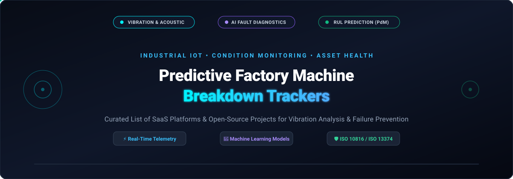

# 🏭 Awesome Predictive Factory Machine Breakdown Trackers

<p align="center">
  <a href="https://github.com/ishandutta2007/Awesome-Awesome-Awesome"></a>
  <a href="https://discord.gg/jc4xtF58Ve"></a>
  <a href="LICENSE"></a>
  <a href="https://github.com/ishandutta2007/Awesome-Predictive-Factory-Machine-Breakdown-Trackers/stargazers"></a>
  <a href="https://github.com/ishandutta2007/Awesome-Predictive-Factory-Machine-Breakdown-Trackers/network/members"></a>
  <a href="https://github.com/ishandutta2007/Awesome-Predictive-Factory-Machine-Breakdown-Trackers/issues"></a>
  <a href="https://github.com/ishandutta2007/Awesome-Predictive-Factory-Machine-Breakdown-Trackers/pulls"></a>
  <a href="https://github.com/ishandutta2007"></a>
</p>

<p align="center">
  
</p>

A curated directory of **Enterprise SaaS Platforms** and **Open-Source Software** for **Predictive Factory Machine Breakdown Tracking**, **Condition-Based Monitoring (CBM)**, **Vibration Analysis**, and **Remaining Useful Life (RUL) Prediction**.

These solutions empower reliability engineers, maintenance technicians, and plant operators to monitor rotating industrial assets (electric motors, gearboxes, pumps, centrifugal compressors, spindles, and conveyor systems) via vibration, ultrasound, temperature, and magnetic flux sensors paired with advanced machine learning to detect micro-anomalies weeks or months before catastrophic failure.

---

## 📑 Table of Contents

- [🌐 Sector Overview & Market Dynamics](#-sector-overview--market-dynamics)
- [🏢 Enterprise SaaS & Hosted Platforms](#-enterprise-saas--hosted-platforms)
- [💻 Open-Source GitHub Projects](#-open-source-github-projects)
  - [📊 Time-Series Databases & Visualization](#-time-series-databases--visualization)
  - [🧠 Machine Learning & Anomaly Detection Frameworks](#-machine-learning--anomaly-detection-frameworks)
  - [🔌 Industrial Protocol Adapters & Edge IoT](#-industrial-protocol-adapters--edge-iot)
  - [🔧 End-to-End PdM Implementations & CMMS](#-end-to-end-pdm-implementations--cmms)
- [🛠️ Recommended Architecture for Self-Hosted PdM](#️-recommended-architecture-for-self-hosted-pdm)
- [🔍 SEO & Technical Keywords](#-seo--technical-keywords)
- [🤝 How to Contribute](#-how-to-contribute)
- [📈 Star History](#-star-history)
- [💖 Support & Community](#-support--community)
- [⚠️ Disclaimer](#️-disclaimer)

---

## 🌐 Sector Overview & Market Dynamics

The global industrial predictive maintenance and breakdown tracking market was valued at **$10.5 Billion in 2024** and is projected to surpass **$48.5 Billion by 2030**, reflecting a rapid **29.5% Compound Annual Growth Rate (CAGR)** driven by Industry 4.0 adoption, affordable edge micro-electromechanical sensors (MEMS), and cloud AI analytics.

The market structure is **moderately fragmented**: while legacy multi-billion-dollar industrial automation conglomerates (Siemens, Schneider Electric/AVEVA, Emerson, Rockwell Automation) control the incumbent operational technology (OT) and SCADA infrastructure, modern agile AI unicorns (Augury, MaintainX, Uptake) and modular open-source stacks prevent a winner-take-all monopoly by dominating self-service sensor diagnostics, mobile CMMS workflows, and on-premises data-sovereign deployments.

---

## 🏢 Enterprise SaaS & Hosted Platforms

The following SaaS and hosted platforms provide commercial-grade machine health tracking, automated fault diagnostics, and computerized maintenance management. The table is **sorted in descending order by company size** (market capitalization or latest enterprise valuation).

| 🏢 Platform / Vendor | 📊 Company Size (Valuation / Revenue) | 💰 Specific Starting Tier Pricing | 🎁 Free Tier Limit & Trial Policy | ⚙️ Primary Focus & Sensor Telemetry |
| :--- | :--- | :--- | :--- | :--- |
| **[Siemens Senseye PdM](https://www.siemens.com/)** | **~$155.0B Market Cap**<br>*(Siemens AG, ~$83B Rev)* | **$7.50 – $25 / asset / month**<br>*(Scales by connected machine assets, unlimited user seats)* | **30-Day Guided Pilot**<br>*(Scoped up to 50 assets; no permanent free tier)* | Automated asset intelligence, OEM-agnostic data integration, OEE improvement, vibration and motor current telemetry. |
| **[AVEVA Predictive Analytics](https://www.aveva.com/)** | **~$135.0B Parent Market Cap**<br>*(Schneider Electric, ~$40B Rev)* | **~$15,000 / year base**<br>*(AVEVA Flex credit subscription tier for entry asset cluster)* | **30-Day Guided PoC**<br>*(Single plant site, up to 10 assets validated against historical failure logs)* | Catch developing failures using Remaining Useful Life Estimation (RULE), sensor drift detection, and native AVEVA PI System integration. |
| **[Emerson Plantweb Insight](https://www.emerson.com/)** | **~$68.0B Market Cap**<br>*(Emerson Electric, ~$17.5B Rev)* | **~$1,500 / year / application**<br>*(Base software license for 10–25 wireless endpoints)* | **30-Day Trial License**<br>*(Limited to 1 wireless gateway and up to 10 wireless asset nodes)* | Pre-built analytics for pumps, steam traps, heat exchangers, and relief valves via WirelessHART vibration & acoustic sensors. |
| **[Fiix by Rockwell](https://fiixsoftware.com/)** | **~$31.0B Parent Market Cap**<br>*(Rockwell Automation, ~$9.1B Rev)* | **$45 / user / month**<br>*(Basic plan, 5-user minimum commitment billed annually)* | **Free Forever Tier**<br>*(Limited to 3 users, 20 assets, and 25 scheduled preventive maintenance tasks)* | Cloud-based CMMS with automated work-order dispatching triggered by sensor anomalies and two-way SAP/ERP synchronization. |
| **[Uptake Fleet](https://uptake.com/)** | **~$2.3B Valuation**<br>*(Acquired/Partnered with Bosch)* | **$45 / vehicle / month**<br>*(Billed annually; entry commercial fleet package)* | **60-Day Guided Pilot**<br>*(Includes Free Fleet Health Assessment for up to 25 commercial vehicles)* | AI-driven predictive maintenance for commercial vehicle fleets, monitoring J1939 telematics codes, gearbox, and engine breakdown vectors. |
| **[SparkPredict (Avathon)](https://www.sparkcognition.com/)** | **~$1.4B Valuation**<br>*(Avathon / SparkCognition unicorn)* | **$3,500 / month**<br>*(~$42,000/year enterprise base package on Cisco HyperFlex/Cloud)* | **30-Day Sandbox PoC**<br>*(Evaluates historical sensor logs for 1 asset category; no permanent free tier)* | Cognitive anomaly detection utilizing supervised & unsupervised deep learning on SCADA, turbine, and high-speed compressor feeds. |
| **[Augury Machine Health](https://www.augury.com/)** | **~$1.07B Valuation**<br>*(Series E Unicorn)* | **$50 – $125 / machine / month**<br>*(~$600–$1,500/machine/yr turnkey DaaS bundle)* | **30-Day Proof of Value (PoV)**<br>*(Targeted pilot deployment covering 20–50 critical rotating assets)* | Full-stack Machine Health-as-a-Service with proprietary Halo wireless vibration, ultrasound, magnetic flux, and human vibration diagnostics. |
| **[MaintainX](https://www.getmaintainx.com/)** | **~$1.0B Valuation**<br>*(Series C Unicorn)* | **$21 / user / month**<br>*(Essential tier billed monthly; $16/mo billed annually)* | **Free Forever Basic Plan**<br>*(Unlimited requesters, 2 repeating PM work orders, 3 procedure work orders/mo)* | Mobile-first frontline maintenance management, barcode/QR asset lookup, and condition-based IoT sensor trigger integrations. |
| **[UpKeep](https://upkeep.com/)** | **~$350M Valuation**<br>*(Series B funded, $50M+ raised)* | **$24 / user / month**<br>*(Essential tier billed monthly; $20/mo billed annually)* | **14-Day Free Trial**<br>*(Full Business Plus access, no credit card required; free view-only requesters)* | Asset operations management with Nova AI assistant, Edge IoT vibration sensors, and automated condition monitoring workflows. |
| **[Nanoprecise Sci Corp](https://nanoprecise.io/)** | **~$100M+ Valuation**<br>*(Series C funded, $60M+ raised)* | **$45 – $75 / sensor / month**<br>*(MachineDoctor 6-in-1 hardware + RotationLF SaaS)* | **30-Day Pilot Program**<br>*(Hands-on evaluation kit with up to 5 wireless MachineDoctor sensors)* | 6-in-1 cellular/Wi-Fi wireless sensors capturing vibration, acoustics, magnetic flux, RPM, and temperature for early bearing failure detection. |

---

## 💻 Open-Source GitHub Projects

Explore open-source alternatives for building self-hosted predictive maintenance pipelines, custom vibration feature extractors, and open CMMS backends. 

Repositories are **sorted in descending order by GitHub Stars_Count**. Each badge links directly to the repository's stargazers page.

| 📦 Repository & Project | ⭐ GitHub_Stars | 🏷️ Category & Tech Stack | 📝 Description & Architectural Utility |
| :--- | :---: | :--- | :--- |
| **[Grafana](https://github.com/grafana/grafana)** | [](https://github.com/grafana/grafana/stargazers) | Visualization & Dashboards<br>`Go` `TypeScript` | The industry-standard open visualization suite. Builds real-time factory machine health dashboards, waterfall FFT plots, and alert thresholds. |
| **[InfluxDB](https://github.com/influxdata/influxdb)** | [](https://github.com/influxdata/influxdb/stargazers) | Time-Series Database<br>`Go` `Rust` | High-write throughput time-series database optimized for storing high-frequency accelerometer streams and temperature telemetry. |
| **[TimescaleDB](https://github.com/timescale/timescaledb)** | [](https://github.com/timescale/timescaledb/stargazers) | Time-Series Database<br>`C` `SQL` | Relational time-series database engineered as a PostgreSQL extension, enabling unified SQL queries across sensor streams and asset inventories. |
| **[ThingsBoard](https://github.com/thingsboard/thingsboard)** | [](https://github.com/thingsboard/thingsboard/stargazers) | IoT Device Platform<br>`Java` `TypeScript` | Open-source IoT server for fleet device provisioning, industrial MQTT/CoAP broker, rule engine data filtering, and condition alerts. |
| **[sktime](https://github.com/sktime/sktime)** | [](https://github.com/sktime/sktime/stargazers) | Time-Series ML<br>`Python` | Scikit-learn-compatible framework providing time-series classification, regression, clustering, and transformation algorithms for sensor signals. |
| **[PyOD](https://github.com/yzhao062/pyod)** | [](https://github.com/yzhao062/pyod/stargazers) | Anomaly Detection<br>`Python` | Comprehensive toolkit containing over 60 outlier detection algorithms (AutoEncoders, Isolation Forests, COPOD) for multivariate telemetry. |
| **[Darts](https://github.com/unit8co/darts)** | [](https://github.com/unit8co/darts/stargazers) | Time-Series ML<br>`Python` | User-friendly library for forecasting and anomaly detection on multivariate sensor time series, using ARIMA, TFT, and DeepAR models. |
| **[Salesforce Merlion](https://github.com/salesforce/Merlion)** | [](https://github.com/salesforce/Merlion/stargazers) | Time-Series AI<br>`Python` | Framework offering automated machine learning (AutoML) for time-series forecasting, root-cause diagnosis, and unsupervised anomaly detection. |
| **[open62541](https://github.com/open62541/open62541)** | [](https://github.com/open62541/open62541/stargazers) | Industrial Protocol<br>`C` `C++` | Open-source, zero-dependency C implementation of OPC UA (IEC 62541) for connecting directly to industrial PLCs, CNC controllers, and SCADA. |
| **[Alibi Detect](https://github.com/SeldonIO/alibi-detect)** | [](https://github.com/SeldonIO/alibi-detect/stargazers) | Drift & Outlier Detection<br>`Python` | Specialized library for detecting statistical concept drift, covariate shift, and sensor degradation in real-time industrial production data. |
| **[NannyML](https://github.com/NannyML/nannyml)** | [](https://github.com/NannyML/nannyml/stargazers) | Post-Deployment Data Science<br>`Python` | Monitors deployed machine learning models in production without ground truth labels, detecting model degradation before false alarms propagate. |
| **[Apache PLC4X](https://github.com/apache/plc4x)** | [](https://github.com/apache/plc4x/stargazers) | Industrial Protocol Adapter<br>`Java` `Go` `C` | Universal adapter suite communicating directly with Siemens S7, Modbus, Allen-Bradley Ethernet/IP, and Beckhoff ADS without proprietary drivers. |
| **[EdgeX Foundry](https://github.com/edgexfoundry/edgex-go)** | [](https://github.com/edgexfoundry/edgex-go/stargazers) | Edge Computing Framework<br>`Go` | Linux Foundation edge platform providing vendor-neutral microservices between factory-floor OT equipment and cloud analytics servers. |
| **[Predictive-Maintenance-using-LSTM](https://github.com/umbertogriffo/Predictive-Maintenance-using-LSTM)** | [](https://github.com/umbertogriffo/Predictive-Maintenance-using-LSTM/stargazers) | Deep Learning RUL<br>`Python` `Keras` | Multivariate time-series regression applying Long Short-Term Memory (LSTM) recurrent neural networks to predict remaining operating cycles. |
| **[LSTMs for Predictive Maintenance](https://github.com/Azure/lstms_for_predictive_maintenance)** | [](https://github.com/Azure/lstms_for_predictive_maintenance/stargazers) | Deep Learning RUL<br>`Jupyter` `Python` | Microsoft Azure architecture validating LSTM models on NASA turbofan degradation benchmarks for time-to-failure calculations. |
| **[PredictiveMaintenance-and-Vibration-Resources](https://github.com/Charlie5DH/PredictiveMaintenance-and-Vibration-Resources)** | [](https://github.com/Charlie5DH/PredictiveMaintenance-and-Vibration-Resources/stargazers) | Curated Research & Datasets<br>`Markdown` | Exhaustive collection of academic papers, bearing vibration frequency benchmarks, and open datasets (CWRU, IMS, MFPT, NASA CMAPSS). |
| **[SuperCMMS Backend](https://github.com/SuperCMMS/Open-Source-CMMS)** | [](https://github.com/SuperCMMS/Open-Source-CMMS/stargazers) | CMMS & Work Orders<br>`TypeScript` `Node.js` | Open-source maintenance management backend featuring asset hierarchies, work orders, preventive scheduling, and QR inventory tracking. |
| **[AC Motors PdM System](https://github.com/juanpdeleon/proyecto_motores)** | [](https://github.com/juanpdeleon/proyecto_motores/stargazers) | Embedded Hardware & IoT<br>`C++` `Python` | Open-source hardware & software stack for induction motors using ESP8266 microcontrollers, MEMS accelerometers, and LSTM neural networks. |

---

## 🛠️ Recommended Architecture for Self-Hosted PdM

A completely self-hosted, enterprise-capable predictive maintenance stack can be assembled using the open-source projects above:

```
┌────────────────────────────────────────────────────────┐
│  Factory Floor Assets: Motors, Pumps, Compressors      │
└───────────────────────────┬────────────────────────────┘
                            │ (Vibration, Temperature, Current)
                            ▼
┌────────────────────────────────────────────────────────┐
│  Data Ingestion Layer: Apache PLC4X & open62541        │
│  (Modbus, OPC UA, Siemens S7, EtherNet/IP)             │
└───────────────────────────┬────────────────────────────┘
                            ▼
┌────────────────────────────────────────────────────────┐
│  Edge Computing & Device Gateway: EdgeX / ThingsBoard  │
└───────────────────────────┬────────────────────────────┘
                            ▼
┌────────────────────────────────────────────────────────┐
│  Time-Series Storage: InfluxDB or TimescaleDB          │
└───────────────────────────┬────────────────────────────┘
                            ▼
┌────────────────────────────────────────────────────────┐
│  AI / Anomaly Engine: PyOD, Darts, sktime, Alibi       │
│  - Fast Fourier Transform (FFT) & Wavelet Transforms   │
│  - ISO 10816-3 Velocity RMS Threshold Verification     │
│  - LSTM Remaining Useful Life (RUL) Forecaster         │
└───────────────────────────┬────────────────────────────┘
                            ▼
┌────────────────────────────────────────────────────────┐
│  Action & Visualization: Grafana + SuperCMMS Backend   │
│  - Real-time Vibration Waterfall Spectrograms          │
│  - Automated Corrective Work-Order Creation            │
└────────────────────────────────────────────────────────┘
```

---

## 🔍 SEO & Technical Keywords

To assist industrial engineers, developers, and reliability specialists searching for relevant diagnostic tools, this repository covers the following core industry terminology:

- **Condition Monitoring (CM) & Condition-Based Maintenance (CBM)**: Continuous real-time asset telemetry tracking against ISO 10816-1 / ISO 20816 standards.
- **Vibration Analysis & Spectral Diagnostics**: Fast Fourier Transform (FFT), peak-to-peak acceleration, velocity RMS, envelope demodulation for inner/outer race bearing faults (BPFO, BPFI, BSF, FTF).
- **Remaining Useful Life (RUL)**: Prognostics and Health Management (PHM) estimation models using degradation modeling and Weibull reliability distributions.
- **Computerized Maintenance Management Systems (CMMS)**: Bridging telemetry triggers into automated technician work orders, parts inventory procurement, and mean-time-between-failures (MTBF) tracking.
- **Operational Technology (OT) & IIoT Gateways**: OPC UA, MQTT Sparkplug B, Modbus TCP/RTU, and edge sensor telemetry pipelines.

---

## 🤝 How to Contribute

Contributions are warmly welcomed! Help keep this curated list accurate and comprehensive:

1. **Fork this repository** to your GitHub account.
2. **Add or modify entries** in [`README.md`](README.md), ensuring strict consistency with existing formats:
   - For SaaS tools: include verified starting tier pricing, free tier/trial limits, and company valuation or revenue.
   - For Open-Source projects: provide the repository link and descriptive technical capabilities.
3. **Submit a Pull Request** with a concise description of your changes.

---

## 📈 Star History

[](https://star-histyry.dera.page/#ishandutta2007/Awesome-Predictive-Factory-Machine-Breakdown-Trackers&type=date&legend=top-left)

---

## 💖 Support & Community

Thank you for exploring and utilizing the **Awesome Predictive Factory Machine Breakdown Trackers** ecosystem! 🏭✨

If you find this repository valuable for your predictive maintenance pipelines, industrial engineering projects, or research:
- ⭐ **Star this repository** to help others discover it!
- 🍴 **Fork the repo** and contribute new tools, sensors, or benchmarks.
- 📢 **Share it** with fellow reliability engineers, maintenance teams, and data scientists on LinkedIn, Twitter/X, and technical forums.

Want to support ongoing maintenance and curation of open industrial AI resources?
<p align="left">
  <a href="https://github.com/sponsors/ishandutta2007">
    
  </a>
</p>

---

## ⚠️ Disclaimer

- This repository is a **community-curated directory** provided for educational, architectural, and evaluation purposes only.
- Predictive breakdown monitoring in industrial environments must strictly adhere to machinery safety directives (such as CE, OSHA, and ISO 13849 safety of machinery).
- **Automated AI alerts must always be validated by certified vibration analysts and qualified maintenance personnel** prior to taking physical machinery offline or performing high-voltage mechanical intervention.
- False positive alerts may trigger expensive unplanned downtime, while false negative omissions can risk severe equipment failure and safety hazards.
